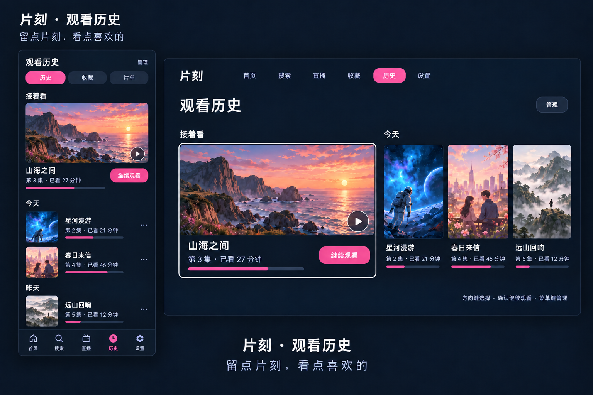
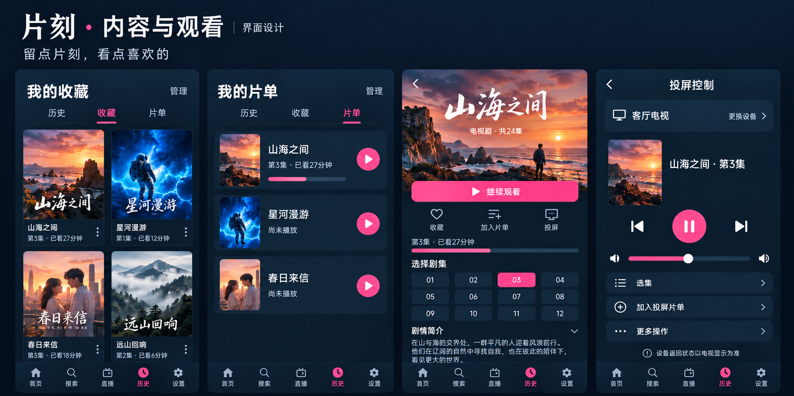
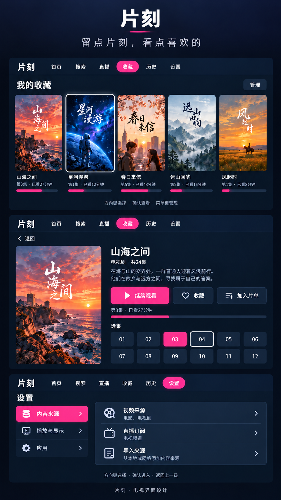
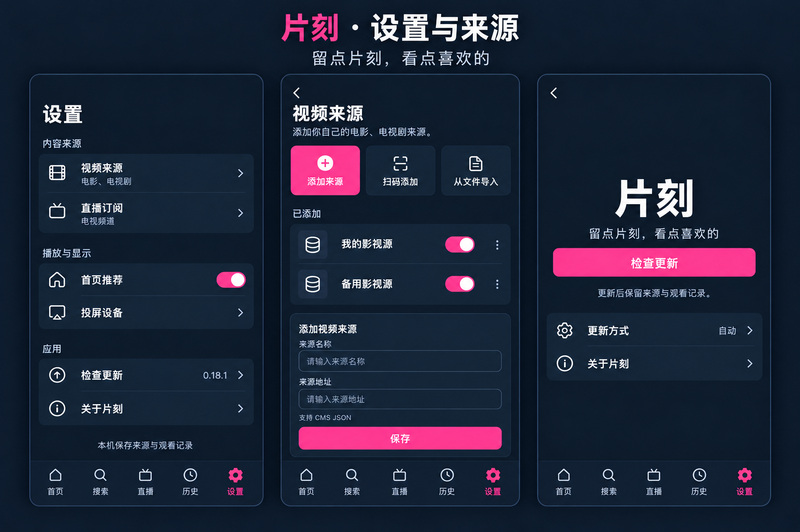

# 片刻：界面设计

> 留点片刻，看点喜欢的

片刻是一款面向手机和电视的原生 Android 影音客户端。名字来自日常留给自己的观看时间；产品使用「留光」图像作为图标，应用名称保留片刻。仓库及下载地址保持原样。

宣传语固定使用「留点片刻，看点喜欢的」。适合放在介绍卡片、关于页和更新页的名称下方，作为次级文字；内容浏览和播放页面不重复堆放。四组设计卡片已加入此句；设置与更新卡片在应用名称下方展示其页面用法。

## 当前图标：留光

用户最终选择独立的图像A「留光」：深蓝背景中一束暖光照亮画面。当前开发源码使用独立手机launcher（普通/圆形/自适应）与TV横幅，首页、关于和更新页统一使用同一图像；随0.19.1提供。正常页面标题和宣传语仍使用文字。

## 历史字标草案

使用略微前倾的中文文字、粉色渐变与两段短刻线，保留文字品牌，不另加图形图标。字形和宣传语已转为路径，放大不失真，不依赖接收端字体。

[透明背景SVG字标](brand/pianke-wordmark.svg) · [完整SVG卡片](brand/pianke-brand-card.svg) · [PNG预览](brand/pianke-brand-card.png)

## 视觉原则

沿用现有深色背景、粉色强调与圆角面板。内容页以海报、片名和观看进度为主；设置页以清晰的分组列表和轻量图标为主，不使用电影海报装饰来源配置。每个页面突出一个主要操作，其余操作放入辅助入口或管理菜单。

手机保留首页、搜索、直播、历史、设置五个入口。电视使用适合远距离阅读的字号和间距，明确区分当前内容与遥控焦点：粉色表示当前项，白色边框表示焦点。主要操作应能通过方向键与确认键完成。

## 三种布局与方向

触摸端跟随系统的方向与旋转锁定设置（user），不根据车机品牌强制横屏。系统旋转或调整窗口时，在同一Activity中重排，保留当前页面、输入草稿、已加载搜索结果和剧集；提交操作完成后再重排，不重复发起搜索或投屏发送。

| 场景 | 导航与内容 | 交互 |
| --- | --- | --- |
| 竖屏手机 | 底部五入口、内容纵向排列 | 触摸；播放器单击显隐、双击左右各10秒 |
| 横屏触摸设备（车机/平板/手机横屏） | 左侧五入口、紧凑首页；足够宽时详情和设置双列；结果/收藏/频道按内容宽度排布 | 触摸；窄高不足时页面和侧栏各自可滚动 |
| 横屏TV | 既有TV首页、列表及播放器 | 方向键、确认、返回；隐藏态点播左右定位，直播左右切台 |

触摸端直播的系统返回与页面返回一致：打开横屏选台覆盖层时先关闭覆盖层，其余状态直接返回频道列表，包括缓冲、重连或报错；不先隐藏控制栏，也不依赖切回竖屏。TV遥控仍按返回先收起选台或控制栏，再返回列表。

首轮适配检查横屏16:9与4:3。实际用户车机的固件、显示方向及系统遮挡仍需真机验证；横屏触摸页不复用TV遥控焦点布局。详情/设置不足双列宽度时回落为单列，点击区域保持触摸尺寸。

## 页面统一方案

| 页面 | 设计方向 |
| --- | --- |
| 历史 | 继续观看主卡、海报与真实进度，日期分组，清理操作收进管理 |
| 收藏 | 海报网格，点击进入详情，移除操作放入管理菜单 |
| 片单 | 海报、剧集/进度与继续播放；保留当前片单业务含义 |
| 详情 | 海报与片名、一个主播放按钮、轻量收藏/片单操作、独立选集区域 |
| 设置 | 内容来源、播放与显示、应用三个分组；来源和更新配置进入二级页 |
| 视频来源 | 手动添加、扫码、文件导入；来源使用图标，开关和更多操作清楚分离 |
| 直播订阅 | 与视频来源分开，保留 M3U 格式提示、订阅更新及频道分类 |
| 更新/关于 | 片刻文字名称、当前版本、检查更新；更新通道放二级设置，保留错误恢复和许可致谢 |
| 投屏控制 | 先展示设备和当前内容，简化常用控制；本轮仅整理现有能力的设计方向 |
| 空状态与错误 | 用易懂文案给出重试/添加入口；删除等操作保留确认 |

不编造未知进度或剩余时长，不把发送投屏指令等同于接收设备已执行，不在宣传图中加入真实来源地址或设备信息。

## 设计卡片

下列图片是界面设计，不是已发行版本的实测截图。历史截图及发布证据保留原样，新设计单独归档。卡片使用片刻名称，不添加发布状态标签。

## 开发进展

2026-10-29：当前开发源码已接入片刻名称与原生矢量字标，并实现手机/TV内容页和设置页的统一布局；这些调整随0.19.0提供。上方仍保留原始设计图，实际开发截图单独归档于NAS仓的 `promo/previews/2026-10-29-pianke/raw/`。投屏扩展暂不实施。

## 实施边界

更名保留既有包名、签名、更新路径及仓库地址，保证后续可以沿用升级链路；保留 LibreTV 渊源和第三方许可说明。页面实现与验收范围以当轮开发记录为准，不因文档图片提前宣称完成。

投屏扩展方向见 [投屏计划](../casting-plan.md)。
